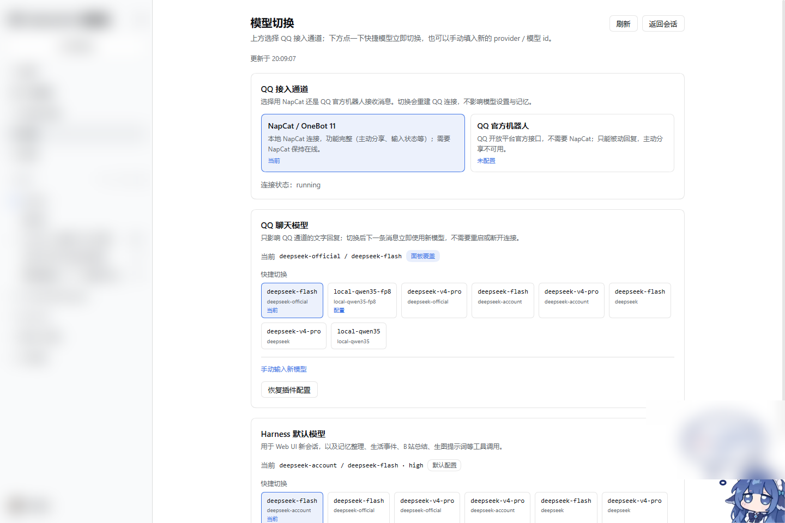

<div align="center">

# DshPet · 情感陪伴型 AI 助手

**一个跑在 [DeepSeek Harness](https://github.com/deepseek-ai) 上的中文情感陪伴 AI 助手**

8+1 人设模块 · 短期 + 七层长期记忆 · QQ 双通道 · 每日生活事件 · 本地 ComfyUI 生图 · 多角色隔离


</div>

> **演示角色：奥菲莉亚·菲尼克斯（Ophelia Phoenix）**
> 白昼档案馆第七阅览室的记录官、圣栎魔法学院首席毕业生。仓库里的角色数据均为**虚构示例数据**，可直接替换成你自己的角色。


---

## 目录

- [这是什么](#这是什么)
- [项目成果](#项目成果)
- [功能一览](#功能一览)
- [架构](#架构)
- [核心设计](#核心设计)
  - [1. 人设系统：8+1 模块](#1-人设系统81-模块)
  - [2. 记忆系统：短期 + 七层长期](#2-记忆系统短期--七层长期)
  - [3. QQ 双通道](#3-qq-双通道)
  - [4. 每日生活事件与「注意力」](#4-每日生活事件与注意力)
  - [5. 本地 ComfyUI 生图](#5-本地-comfyui-生图)
  - [6. B 站观看](#6-b-站观看)
  - [7. 多角色：独立人设 + 独立记忆](#7-多角色独立人设--独立记忆)
- [快速开始](#快速开始)
- [仓库结构](#仓库结构)
- [文档索引](#文档索引)
- [已知限制与免责声明](#已知限制与免责声明)
- [License](#license)

---

## 这是什么

DshPet 是一套 **DeepSeek Harness 插件**，把一个普通 Agent 会话变成**长期在线的角色**：

- **她记得你**：每轮对话写进记忆，凌晨自动整理成短期 + 七层长期记忆，越常提到的事越容易被想起；
- **她有自己的人设**：8 个固定人设模块 + 1 个可扩展的「个人经历」模块，区分「始终生效」与「被问到才用」，减少长篇设定挤占上下文；
- **她能在 QQ 上陪你**：NapCat（OneBot 11）或 QQ 官方机器人双通道，白名单只允许你本人；
- **她有自己的生活**：每天生成一份生活日程，到点主动私聊分享见闻；你停在聊天框时她会自己找话题；
- **她会画画**：聊天进入新场景时调用本地 ComfyUI 生成角色插画，固定二次元画风；
- **她能自己刷 B 站**：按兴趣标签看视频、写记忆，偶尔在评论区和你分享。

整套系统的记忆、人设、生活计划都是**磁盘上的中文 JSON**，可以直接打开、修改、备份。

---

## 项目成果

| 维度 | 结果 |
|---|---|
| 自动化测试 | **232 项全部通过**（`node --test`，覆盖记忆 / 人设 / 生活事件 / IM / QQ / 生图） |
| 独立验收 | **118 条验收用例**，覆盖 **25 个模块组**（M / P / I / C / QC / QW / QB / QV / QL / QM / CM / SM / PE / PL / PP / PV / RL / DL / LM / TM / GL / CTX / BL …） |
| 代码规模 | 插件与 Web UI 客户端约 **3 万行 JavaScript**，测试约 **7.7 千行**，**零 npm 运行时依赖**（只用 `node:*` 内置模块） |
| 人设 | 8 + 1 模块，含 16 组说话风格参考示例；「始终生效 / 被问到才用」两档注入策略 |
| 记忆 | 短期 + 七层长期；衰减阈值 1 / 3 / 7 / 14 / 30 / 140 天；层级压缩、会话话题记忆、按需检索 |
| QQ 接入 | NapCat / OneBot 11 与 QQ 官方机器人双通道，可在 Web UI 一键切换 |
| 生图 | 固定画风二次元、结构化提示词 `ophelia-image-prompt/2`、ComfyUI 懒启动 |
| 可解释性 | 真实账号状态写入 `status.json`；每次记忆维护生成中文 `记忆总览.md` |

### 效果预览

**Web UI：QQ 接入通道与模型切换面板**



**同一套代码生成的插画（固定画风）**

| 画风示例 | 场景示例 |
|---|---|
|  |  |

**角色设计参考图**


> 以上插画均由项目内 ComfyUI 生图链路生成，用于演示「固定画风 + 结构化提示词 + 外观记忆」的效果。

---

## 功能一览

| 模块 | 能力 |
|---|---|
| **人设系统** | 9 个模块（角色定义 / 说话风格 / 她自己 / 记忆和承诺 / 规则 / 外貌 / 其他同僚 / 身份设定 / 个人经历）；支持从人设卡 JSON 一键导入 |
| **记忆系统** | 短期记忆 + 七层长期记忆；提及次数上浮、久未提及下沉、层级精确压缩、会话话题记忆、关键词检索、上下文压力压缩 |
| **多角色** | 一个角色一个目录（人设 + 记忆 + 生活 + QQ 会话）完全隔离；脚本一键新增角色 |
| **QQ 双通道** | NapCat（OneBot 11 WebSocket）与 QQ 官方机器人（WebSocket 网关 + OpenAPI 被动回复）；白名单、多气泡、识图、识表情包、按需联网 |
| **每日生活事件** | 凌晨记忆维护后生成次日日程；到点主动私聊分享，分享内容写入记忆 |
| **注意力** | 检测「对方正在输入」，持续停留超过阈值时主动找话题（优先级：上下文 → 短期记忆 → 随手念头） |
| **生图** | LLM 导演判断场景，调用本地 ComfyUI 生成插画；外观记忆参与提示词；画风锁定 |
| **B 站观看** | 按兴趣标签看视频、总结成记忆、评论区 @ 主人推荐；扫码登录 |
| **Web UI** | 「模型」页内置 QQ 通道切换、QQ 聊天模型、Harness 默认模型三块面板，改动即时生效 |

---

## 架构

```
DeepSeek Harness（desktop / web profile）
│
├── companion-host（Host 插件，随 Harness 启动）
│   ├── 扫描 companion-data/characters/ 下所有角色
│   ├── 每 10 分钟检查 04:00–06:00 记忆维护窗口，逐角色独立维护（含补跑）
│   ├── 维护后生成「第二天」生活计划（lib/life）
│   └── B 站观看调度（lib/bilibili）
│
├── companion-qq（Host 插件）
│   ├── 按 qq/channel.json 选择通道：
│   │   ├── NapCat（OneBot 11 WS）
│   │   └── QQ 官方机器人（WebSocket 网关 + OpenAPI 被动回复）
│   ├── 回复：人设 + 记忆 +（按需）联网检索 + 图片/表情包输入
│   │         → 一条一段、多气泡发送
│   └── 主动分享：读取生活计划，到点私聊（仅 NapCat 通道）
│
└── 每个角色一个「情感陪伴 · 名字」预设（新建会话时选择）
    └── companion-core（preset 作用域插件；dataDir = 该角色目录）
        ├── 人设段   → 注入 system prompt
        ├── 记忆摘要 → 每步动态注入 system prompt
        ├── 工具     → persona_lookup / memory_recall / memory_note
        │              / memory_status / persona_status
        └── 监听用户消息 → 写入该角色自己的记忆
```

所有数据都在磁盘上：

```
companion-data/
└── characters/
    └── ophelia/                          # 一个角色一个目录（角色 id）
        ├── character.json                # 角色元数据
        ├── persona/persona.json          # 该角色独立人设（中文，可直接编辑）
        ├── memory/
        │   ├── short-term.json           # 短期记忆
        │   ├── long-term/layer-1…7.json  # 七层长期记忆
        │   ├── meta.json / index.json    # 维护时间、关键词索引
        │   ├── 记忆总览.md                # 自动生成的中文总览
        │   └── events.jsonl              # 记忆事件日志
        ├── life/day-plan-YYYY-MM-DD.json # 每日生活计划
        ├── images/generated/             # 生图产物
        ├── bilibili/account.json         # B 站登录（含凭据，勿提交）
        └── qq/                           # sessions / status / channel
```

---

## 核心设计

### 1. 人设系统：8+1 模块

人设是一份可直接编辑的中文 JSON。每个模块有明确的**生效方式**：

| 模块 id | 中文名 | 生效方式 | 作用 |
|---|---|---|---|
| `role_definition` | 角色定义 | 始终生效 | 她是谁、从哪里来、与你的关系、核心驱动 |
| `speech_style` | 说话风格 | 始终生效 | 句式、长度、语气词、颜文字频率、禁用开头 |
| `memory_and_promises` | 记忆和承诺 | 始终生效 | 不编造没发生的事、不许做不到的承诺 |
| `rules` | 规则 | 始终生效 | 安全边界、隐私、处理挑衅 |
| `herself` | 她自己 | 被问到才用 | 喜好、口味、小毛病、发生过的小事 |
| `appearance` | 外貌 | 被问到才用 | 发色、眼睛、服装细节 |
| `other_ai_characters` | 其他同僚 | 被问到才用 | 她认识谁、各自性格 |
| `identity` | 身份设定 | 被问到才用 | 世界观、魔法与学院 |
| `personal_history` | 个人经历 | 被问到才用 | 已归档的过往（可按时间线导入记忆） |

「被问到才用」的模块正文**不进 system prompt**，只留标题索引；模型被问到时必须先调用 `persona_lookup` 读取，读不到就要说记不清，不允许编造。这样既保留人设厚度，又不让设定挤满上下文。

### 2. 记忆系统：短期 + 七层长期

一条记忆长这样：

```json
{
  "id": "mem-000012",
  "content": "主人最喜欢草莓味蛋糕，生日时也会吃这个。",
  "summary": "主人最喜欢草莓味蛋糕。",
  "keywords": ["草莓蛋糕", "喜欢", "生日"],
  "category": "喜好",
  "mentionCount": 3,
  "emphasis": 1,
  "importance": 61,
  "clarity": 0.61,
  "createdAt": "2026-11-05T20:14:00+08:00",
  "layer": 1,
  "history": [{ "at": "2026-11-06T04:30:00+08:00", "from": "short", "to": 1, "reason": "每日夜间转移" }]
}
```

**短期 → 长期**

- 新记忆先进短期记忆（普通记忆默认上限 20 条，会话话题不受限）；
- 短期总字数超 5 万字时，按「重要度低 → 提及次数少 → 更久未提及」把一半转入长期第一层；
- 每天凌晨 04:00–06:00 维护：夜间转移 → 七层衰减 / 上浮 → 层级压缩。

**七层衰减**

| 层 | 多久未被提及就下沉一层 |
|---|---|
| 第 1 层 → 第 2 层 | 1 天 |
| 第 2 层 → 第 3 层 | 3 天 |
| 第 3 层 → 第 4 层 | 7 天 |
| 第 4 层 → 第 5 层 | 14 天 |
| 第 5 层 → 第 6 层 | 30 天 |
| 第 6 层 → 第 7 层 | 140 天 |

- 若某条记忆的**提及次数比上次维护时增加**，就**上浮一层**（上浮优先于下沉）；
- 从第 3 层开始，每次下沉把正文精确压缩为上一次的 **75%**（优先在句末标点截断），并记录 `compaction` 元数据；
- **背景故事不压缩**：人设「个人经历」与故事集导入的记忆始终保留全文。

**会话话题记忆**：QQ 每轮对话按话题聚合（同一会话间隔 ≤30 分钟追加到同一条），单话题超 1 万字压缩最旧对话为《早期对话摘要》，保留最近原文。

**检索**：收到消息时先加载全部短期记忆，再只扫长期记忆的 `keywords`，命中的那几条才被挪回短期并加载正文；需要更久远的记忆时调用 `memory_recall` 显式检索。

### 3. QQ 双通道

```
你的 QQ（白名单）
   │ 私聊 / 群聊 @
   ▼
NapCat（OneBot 11 WebSocket，本地 127.0.0.1:3001）        ← 通道 A
   或  QQ 开放平台机器人（WebSocket 网关 + OpenAPI）      ← 通道 B
   ▼
companion-qq
   ├─ 白名单过滤（只认你；忽略其他人）
   ├─ 写入该角色独立的会话话题记忆
   └─ reply-engine：人设段 + 记忆摘要 + 按需档案 + 最近对话
        ├─ 「帮我查 / 搜一下 / 最新新闻」→ 联网检索后转述（不输出链接）
        ├─ 图片 / 表情包 → 多模态输入 → 视觉模型识别
        └─ ctx.llm 生成回复 → 按换行拆成多条气泡（群聊仅第一条 @你）
```

两种通道可以在 Web UI 左侧「模型」→「QQ 接入通道」随时切换，不影响模型设置与记忆。

### 4. 每日生活事件与「注意力」

- 每天凌晨记忆维护后生成**次日日程**（默认 5–7 个事件，结合最近记忆 + 随机旧记忆 + 网上读到的文章）；
- 事件到点时若你正在聊天，**取消这一轮**，不插在对话之间；
- 分享成功后写入记忆（`source: life-share`），以后聊天能回想起来；
- 「注意力」：NapCat 推送「对方正在输入」后开始计时，持续停留超过 20 秒，她会主动找话题——先接上下文，再翻短期记忆，最后随手分享一个念头；同一用户 10 分钟冷却。

### 5. 本地 ComfyUI 生图

- LLM 导演判断「新场景 / 特殊动作 / 情绪明显」时触发（保守策略，两张图至少间隔 10 秒）；
- 固定提示词格式 `ophelia-image-prompt/2`：`title / scene / characters / action / environment / mood / composition / lighting / palette / style / aspect_ratio / megapixels / prompt_en`；
- **画风写死二次元**：`prompt_en` 最前面固定 `FIXED_IMAGE_STYLE`，并清掉写实 / 摄影 / 3D 等描述；
- 生成结果写回记忆（`metadata.image = true`），下次生图只参考外观 / 动作 / 场景，不继承旧画风；
- ComfyUI 懒启动，默认 10 分钟无活动自动关闭（只关闭由插件启动的实例）。

### 6. B 站观看

- 看视频安排在晚上（默认 19:00–23:00，每天最多 20 个）；按人设 + 记忆 + 兴趣标签搜索；
- 每个视频总结成一条短期记忆（写清具体内容，不只写模糊主题）；
- 有趣时自动扩展兴趣标签；配置 Cookie 后可在评论区 @ 你推荐；
- 扫码登录页：`http://127.0.0.1:<DSH端口>/dsh-companion/bili/login`。

### 7. 多角色：独立人设 + 独立记忆

隔离单位是**角色目录**（也就是记忆引擎的 `dataDir`）：不同角色的人设互不影响、记忆互不可见、维护时间线各自独立。

```powershell
node scripts/add-character.mjs --id xiaoyu --name 小雨 --write-patch
```

新增后重装 bundle / 重启 Harness，新建会话即可选择「情感陪伴 · 小雨」。

---

## 快速开始

> 完整步骤（含 NapCat 安装、模型配置、排错）见 **[docs/教程.md](docs/教程.md)**。

**0. 环境**

- DeepSeek Harness（Desktop 或 Web，profile = `desktop`）
- Node.js ≥ 20（Harness 自带一份 Node，无需单独安装）
- 可选：NapCat（QQ 通道 A）、ComfyUI（生图）、B 站账号（B 站观看）

**1. 获取代码**

```bash
git clone https://github.com/Worril-224/dsh-pet.git
cd dsh-pet
```

**2. 初始化示例数据**

```bash
# 把仓库内的示例角色复制到默认数据目录（~/.dsh/dsh-pet/companion-data）
node scripts/init-data.mjs
# 自定义目录：设置 DSH_PET_DATA_DIR，或 node scripts/init-data.mjs --target <目录>
```

**3. 安装插件 bundle**

任选其一：

- **Web GUI**：左侧「插件」→ 安装本地 bundle → 选择 `<repo>/companion-bundle`；
- **Agent 工具**：`plugin_manager({ action: 'install_bundle', target: '<repo>/companion-bundle' })`；
- **手动**：在 profile 的 `cordis.patch.yml` 追加 `companion-bundle/cordis.patch.yml` 里的行，把 `charactersDir` 改成你的数据目录。

**4. 重启 Harness**

Host 插件与预设只在启动时加载，装完必须重启一次。

**5. 开始聊天**

Web GUI → 新建会话 → 选择预设 **「情感陪伴 · 奥菲莉亚·菲尼克斯」**。

**6.（可选）接入 QQ**

见 [docs/QQ接入-NapCat.md](docs/QQ接入-NapCat.md) 或 [docs/QQ接入-官方机器人.md](docs/QQ接入-官方机器人.md)。**建议用小号**，白名单只填自己的 QQ。

---

## 仓库结构

```
dsh-pet/
├── README.md
├── LICENSE                       # MIT
├── docs/
│   ├── 教程.md                    # 完整使用教程（从零到跑通）
│   ├── SPEC.md                   # 技术规格与实现契约
│   ├── QQ接入-NapCat.md           # 通道 A 操作手册
│   ├── QQ接入-官方机器人.md        # 通道 B 操作手册
│   ├── 角色设计-奥菲莉亚.md        # 示例角色设计说明
│   ├── 数据修改指南.md             # 哪些文件能改、改了会不会被重置
│   ├── 生图.md                    # ComfyUI 生图链路
│   ├── B站观看.md                  # B 站观看与登录
│   └── images/                    # README / 文档配图
├── companion-bundle/             # 插件本体（Host + Preset + QQ + 生图 + B 站）
│   ├── lib/                      # 零依赖实现
│   ├── data/                     # 默认人设模板、ComfyUI 工作流
│   ├── tests/                    # 232 项自动化测试
│   ├── client.js                 # Web UI 扩展
│   └── cordis.patch.yml          # 安装模板
├── companion-data/               # 示例角色数据（虚构示例，可直接替换）
├── scripts/                      # 工具脚本（初始化 / 新增角色 / 导入人设 / 测试 …）
└── 验收/                          # 验收标准、验收报告、独立验收测试
```

---

## 文档索引

| 文档 | 内容 |
|---|---|
| [教程](docs/教程.md) | **从零开始的完整教程**：安装、配置、人设、记忆、QQ、生图、B 站、排错 |
| [SPEC](docs/SPEC.md) | 技术规格：模块契约、数据结构、配置项、边界条件 |
| [QQ 接入 · NapCat](docs/QQ接入-NapCat.md) | 安装 NapCat、登录、开 WS、测试与排错 |
| [QQ 接入 · 官方机器人](docs/QQ接入-官方机器人.md) | 开放平台 AppID / AppSecret、沙箱、被动回复限制 |
| [数据修改指南](docs/数据修改指南.md) | 每个数据文件能不能手改、为什么重启会重置 |
| [生图](docs/生图.md) | ComfyUI 工作流、提示词格式、固定画风机制 |
| [B 站观看](docs/B站观看.md) | 扫码登录、兴趣标签、评论推荐、风控注意 |
| [验收](验收/README.md) | 验收标准、验收报告、独立验收测试 |

---

## 已知限制与免责声明

- **QQ 通道使用非官方协议**（NapCat 通过注入 QQ 客户端实现 OneBot 11）。这**违反 QQ 用户协议，存在封号风险**，请务必使用**小号**，并自行承担风险。官方机器人通道无此风险，但只能被动回复。
- 「每日生活事件」「B 站观看」「注意力」等内容是**角色扮演性质**的生成结果，不是真实日程或真实行为记录。
- 生图、B 站、联网检索依赖外部服务（ComfyUI / B 站 / 搜索），未配置时对应功能自动跳过，不影响聊天。
- 记忆整理、人设一致性依赖模型行为，需要真人对话调优；`persona_lookup` 的实际调用意愿受模型影响。
- 仓库内所有角色、记忆、对话均为**虚构示例数据**，与任何真实个人无关。
- 请勿把你自己的真实聊天记录、QQ 配置、B 站 Cookie 提交到公开仓库（相关文件已在 `.gitignore` 中排除）。

---

## License

[MIT](LICENSE) © 2026 DshPet contributors

角色「奥菲莉亚·菲尼克斯」的设定与示例数据为项目原创虚构内容，随项目以 MIT 协议开源。
