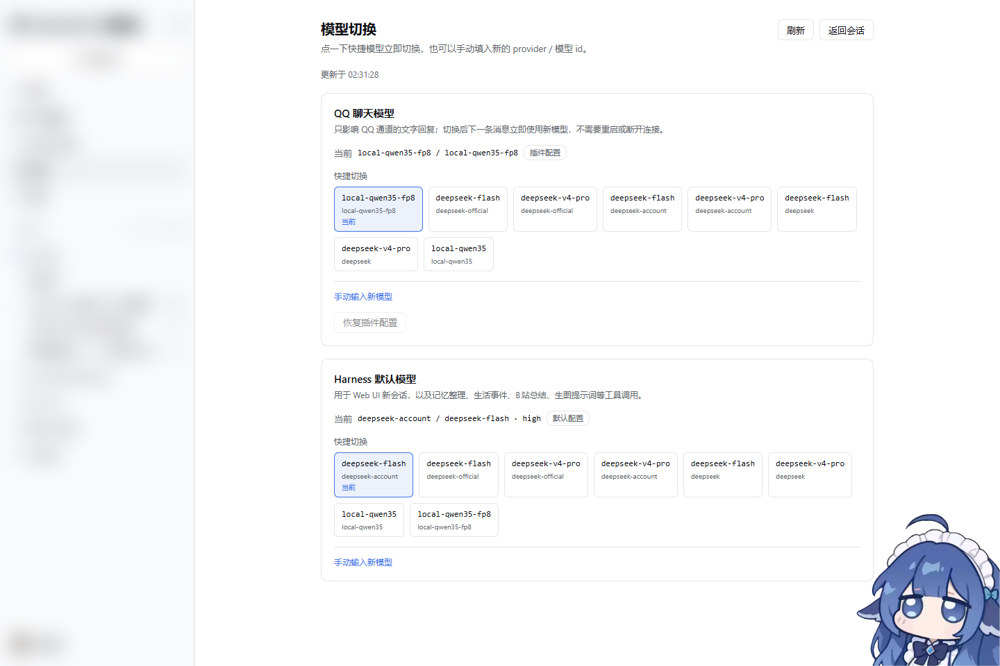

# 把奥菲莉亚接入 QQ（NapCat / OneBot 11 通道）· 操作手册

> 本文以示例配置说明接入流程：
> - **机器人 QQ（她在 QQ 上的账号）**：`123456789`（示例值，换成你准备给小号的 QQ）
> - **主人 QQ（白名单，只允许你本人使用）**：`10001`（示例值，换成你自己的 QQ）
> - **OneBot WebSocket 地址**：`ws://127.0.0.1:3001`（可改）
> - **角色**：`ophelia`（奥菲莉亚）；人设与记忆是她独立的一套，与网页端共用同一份记忆。
> - **插件**：`companion-qq`（Host 插件，随 Harness 启动，自动重连）

接入需要在本机装一个 **NapCatQQ**（QQNT 的非官方 OneBot 11 桥），用机器人 QQ 登录它，Harness 的 `companion-qq` 插件通过 WebSocket 连上它收发消息。

> **也可以走官方通道。** 如果不想继续用 NapCat / 外部注入，可以在 Web UI 左侧「模型」→「QQ 接入通道」切换到 QQ 开放平台官方机器人。步骤见 [QQ接入-官方机器人.md](QQ接入-官方机器人.md)。官方通道只能被动回复，主动分享不可用。

## 0. 准备两个 QQ

| 账号 | 用途 | 说明 |
|---|---|---|
| `10001` | 主人（你自己） | 用这个号跟奥菲莉亚聊天；把它填进白名单 |
| `123456789` | 奥菲莉亚（机器人） | 需要能在 NapCat 里登录；建议**小号**（非官方协议有风险） |

1. 用主人 QQ 搜索并添加 `123456789` 为好友（私聊需要好友关系；部分设置下非好友也可，但建议加）。
2. 如果要在群里用：把 `123456789` 拉进群（群主/管理操作），之后 **@她** 才会回复。

## 1. 安装 NapCatQQ（Windows）

1. 打开 NapCat 官方仓库：<https://github.com/NapNeko/NapCatQQ/releases>
2. 下载 Windows 版（一键包/安装器；通常需要本机已安装 QQNT 客户端，按 release 说明操作）。
3. 启动 NapCat，用 **`123456789`** 登录（扫码或账号密码）。登录后手机端该 QQ 可能被挤下线，属正常现象。
4. 打开 NapCat 的 WebUI（默认 `http://127.0.0.1:6099`，首次可能需要在控制台看 token/二维码）。

## 2. 在 NapCat 里开启 OneBot 11 WebSocket 服务

在 NapCat WebUI → **网络配置**（Network）→ 新建 **WebSocket 服务器（WS Server）**：

| 配置项 | 值 |
|---|---|
| 名称 | `dshpet`（随意） |
| Host | `127.0.0.1` |
| 端口 | `3001` |
| Token | 留空或自己设一个（若设置 token，需要同步填到 Harness 插件 config 的 `accessToken`） |
| 消息格式 | `array`（段数组；插件也兼容 CQ 字符串） |
| 启用 | ✅ |

保存并启用。NapCat 日志里出现类似 `WebSocket server started: ws://127.0.0.1:3001` 即成功。

> 如果 3001 被占用，改成其它端口后，需要同步修改 Harness 插件配置（见第 5 节）并重新安装 bundle。

### 2.1 两个「token」别混淆

| token | 用途 | 在哪里看/改 |
|---|---|---|
| **WebUI 登录 token** | 打开 NapCat 管理页面 `http://127.0.0.1:6099` 时登录用 | NapCat 解压目录下 `config\webui.json` 的 `"token"` 字段；或 NapCat 启动控制台日志 |
| **OneBot WebSocket Token** | Harness 插件连接 WS 时的鉴权；**NapCat 创建 WS 服务器时会自动生成一个 token** | NapCat WebUI → 网络配置 → WS Server 的 Token 字段；或 `config\onebot11_<机器人QQ>.json` 的 `network.websocketServers[].token` |

> **重要**：创建 WebSocket 服务器后，NapCat 可能会自动生成一个 Token（即使界面看起来像留空）。如果 Harness 插件 `accessToken` 与它不一致，连接会反复被关闭（status 显示 failed、lastError 含 code=1005/1006）。两种做法任选：
> 1. 把 NapCat 的 token 填到 `companion-bundle/cordis.patch.yml` 的 `companion-qq.config.accessToken`，重装 bundle/重启 Harness；
> 2. 或在 NapCat 里把该 WS Server 的 Token 清空保存，插件保持 `accessToken: ''`。

- WebUI 打不开（6099 没监听）：通常说明 NapCat 还没完成启动 / 机器人 QQ 还没登录，先看 NapCat 启动窗口或重新运行 NapCat 解压目录下的 `launcher.bat`。
- 查 WebUI token 的命令（PowerShell，路径换成你的 NapCat 解压目录）：

```powershell
Get-Content .\NapCat.Shell\config\webui.json -Raw
# 找 "token": "……"
```

- 如果给 WS Server 设置了 Token，需要同步到 `companion-bundle/cordis.patch.yml` 的 `companion-qq.config.accessToken`，然后重装 bundle/重启 Harness；最省事的做法是**留空**。

## 3. 启动/重启 Harness，检查插件连接状态

Harness 的 `companion-qq` 插件会主动连接 `ws://127.0.0.1:3001`。重启 Harness 后 10 秒内查看角色数据目录下的状态文件：

```text
<数据目录>/characters/ophelia/qq/status.json
```

关键字段（示例）：

```json
{
  "started": true,
  "botQQ": "123456789",
  "allowUsers": ["10001"],
  "onebotUrl": "ws://127.0.0.1:3001",
  "adapter": { "state": "running", "lastError": null },
  "users": []
}
```

> 顶层 `lastError` / `lastActivityAt` 只在实际发生错误或成功回复后出现；没有时省略。

- `adapter.state = "running"` → 已连上 NapCat；
- `"failed"` + `lastError` 含 `code=1006` → 连不上：NapCat 没启动 / 端口不对 / token 不对；
- 插件每 10 秒刷新一次该文件，便于排查。

## 4. 测试聊天

**私聊**：用主人 QQ `10001` 给 `123456789` 发一句「在吗？」  
奥菲莉亚应在几秒内回复（首次可能需要等模型）。

**群聊**：在群里 **@`123456789`** 发消息；只有白名单里的 `10001` @她才会回复，其他人 @ 会被忽略。

回复会写入她自己的记忆（`characters/ophelia/memory/`），后续在网页端或 QQ 里都能延续（人设+记忆共用同一角色目录）。

## 5. 配置在哪里改

`companion-bundle/cordis.patch.yml` 的 `companion-qq` 行（示例）：

```yaml
    - id: companion-qq
      name: '@local/dsh-companion/qq'
      config:
        characterId: ophelia
        onebotUrl: 'ws://127.0.0.1:3001'
        # NapCat 创建 WS 服务器时可能自动生成 token；
        # 若在 NapCat 里重建/清空服务器，需要同步更新此值（或把 NapCat 的 token 清空）。
        accessToken: ''
        botQQ: 123456789
        allowUsers:
          - 10001
        historyLimit: 8
        # 可选：显式指定模型（默认沿用 Harness 当前默认模型）
        # provider: deepseek-official
        # model: deepseek-flash
        maxTokens: 512
        maxReplyChars: 600
        reconnectMinMs: 1000
        reconnectMaxMs: 30000
```

`charactersDir` 不填时使用默认数据目录（`$DSH_PET_DATA_DIR` 或 `~/.dsh/dsh-pet/companion-data`）；自定义时再取消注释填写绝对路径。



改完后需要重新安装 bundle 或重启 Harness：

```js
plugin_manager({ action: 'remove_bundle', target: '@local/dsh-companion' })
plugin_manager({ action: 'install_bundle', target: '<repo>/companion-bundle' })
```

## 6. 常见问题

| 现象 | 原因 / 处理 |
|---|---|
| `adapter.state = failed`，`code=1006` | NapCat 没开、端口错、token 错、防火墙拦截本机回环（少见） |
| 发消息没回复，`lastError` 有「模型路由」 | Harness 当前默认模型不可用：在插件 config 里显式填 `provider`/`model`，或检查 DeepSeek 账号/Key |
| 发消息没回复，`lastError` 有「空回复」 | 模型返回空；稍后重试或缩短 system 上下文 |
| 群聊 @ 没回复 | 不是白名单 QQ；或未 @；或 `allowGroups` 限制（默认不限制群） |
| 回复里有链接 | 回复引擎会清洗链接；若仍出现请贴原文排查 |
| 手机 QQ 显示机器人离线 | NapCat 登录会挤下线，这是登录态问题，不影响收发（NapCat 在线即可） |
| 想换机器人 QQ | 改 `botQQ` 与 `allowUsers`，用新号在 NapCat 登录，重启 Harness |

调试辅助：
- `characters/ophelia/qq/status.json`：连接状态、最近错误、最近活跃时间；
- `characters/ophelia/qq/sessions.json`：每个 QQ 号的最近对话（用于连贯上下文，不含全部记忆）；
- 记忆仍以 `characters/ophelia/memory/` 为准，可用 `memory_status` / 记忆总览核验。

## 7. 防重复登录 / 避免被 QQ 判定机器人

`scripts/napcat-autostart.ps1` 的策略是「宁可等待，不反复登录」：

- 进程完全不存在时：自动启动最多 **1 次/天**，两次至少间隔 4 小时；
- 进程存在但 6099/3001 都没监听、且 6099 WebUI 也没起来：等待 **15 分钟**后最多做 **1 次受控恢复**（结束卡住的进程后用 `-q` 快速登录）；恢复后最多等 **180 秒**确认端口，失败当天不再自动重试，等手动扫码；
- 6099 WebUI 已起来时：不自动 kill，留给人工扫码/处理；
- 所有自动恢复最多 **1 次/天**，两次恢复至少间隔 **12 小时**，不会连续重启；
- 稳定优先：如果当天已经自动恢复过（哪怕实际登录成功但检测延迟），当天不再自动重登，避免重复登录触发风控；
- 当前状态保存在 NapCat 解压目录下的 `autostart-state.json`；
- 想完全禁止自动登录：创建 `NapCat.Shell\STOP_AUTOSTART.flag`，或禁用对应的计划任务。

如果 QQ/NapCat 卡在登录窗口：

1. 手动打开 NapCat 窗口查看二维码/登录提示；
2. 不要反复双击启动器、不要连续重启；
3. 需要重新登录时，只在确认窗口卡死的情况下手动重启一次；
4. 登录后不要反复重启 Harness/NapCat，等 `http://127.0.0.1:3001` 建立即可。

> NapCat 使用 QQNT 非官方注入，本身有风控风险；减少登录频率只能降低概率，不能保证绝对不被踢。

## 8. 安全与注意事项

- 本通道使用 **NapCat（第三方非官方 QQ 协议桥）**，存在账号被限制/封禁的风险 → 务必使用**小号**，不要用主号挂 NapCat。
- 白名单只应填你自己的 QQ；其他人私聊/群 @ 都会被忽略。**不要**把不信任的 QQ 加入 `allowUsers`。
- 机器人 QQ 的密码/登录态由 NapCat 保管，Harness 插件不接触你的 QQ 密码。
- 群聊中她只响应白名单用户 @ 的消息；若以后想多用户使用，需要扩展「每用户独立记忆」，否则记忆会混在一起。
- 机器人回复内容仍受奥菲莉亚人设规则约束（AI 身份披露、不发链接、安全边界、不诱导依赖）。

## 9. 新能力

| 能力 | 怎么用 / 怎么验证 |
|---|---|
| **联网查资料** | 发「帮我查一下今天新闻」「搜一下 Vue3 教程」「最新…」等，她会调用 Harness 的 web 搜索服务，用自己的话回答；回复里的 URL 会被清洗。搜索失败会如实说查不到 |
| **多气泡** | 她的回复按换行/段落拆成多条 QQ 消息（一段一个气泡）；群聊里只有第一条 @你，避免刷屏 |
| **识图 / 识表情包** | 直接发图片或表情包，她通过 `attachments` 把图片交给多模态模型识别后回应；小黄脸表情会转成「微笑/呲牙/偷笑…」等名称 |
| **每日生活事件主动分享** | 凌晨记忆维护后生成「第二天」的日程（时间 + 事件 + 网上读到的文章感想），到点主动私聊你；当天计划缺失时插件启动会补齐 |
| **个人经历入记忆** | 个人经历可按剧情时间线拆成多条记忆（`occurredAt` 发生时间），聊天回答「以前/生日」等更接近真实回忆 |

检查部署状态：

```powershell
Get-Content .\companion-data\characters\ophelia\qq\status.json -Raw
# features.webSearch / features.vision / features.bubbles / proactive 均为 true
Get-ChildItem .\companion-data\characters\ophelia\life
# day-plan-<今天>.json 已生成（sentAt 到点后写入）
```

- 如果 DSH 页面/插件行为异常，重启一次 Harness 可确保加载最新 bundle。
- 联网/识图依赖 Harness 的 `ctx.web` 和 `ctx.attachments` 服务；缺失时自动降级为普通文字回复。
- 每日事件默认时间池 09:20 / 13:40 / 17:10 / 20:30（±20 分钟随机），当天已过时间跳过；超过 6 小时未发不补。
- 个人经历可用 `scripts/seed-persona-memories.mjs`（默认预览，`--write` 写入）按 `PERSONA_HISTORY_TIMELINE` 调整后导入。

## 10. 后台自启与掉线守护（可选）

NapCat 窗口被关闭是 QQ 掉线最常见原因。`scripts/` 下提供了用户级开机自启 + 后台守护脚本：

| 项目 | 说明 |
|---|---|
| 开机自启 | `scripts/install-napcat-autostart.ps1` 注册计划任务/启动项（路径与 QQ 号用参数传入） |
| 守护脚本 | `scripts/napcat-autostart.ps1`（可配 `napcat-autostart-hidden.vbs` 隐藏窗口启动） |
| 守护日志 | NapCat 解压目录下 `logs\autostart.log` |
| 停止守护（不卸载） | 创建文件 `NapCat.Shell\STOP_AUTOSTART.flag` |
| 卸载自启 | `powershell -NoProfile -ExecutionPolicy Bypass -File scripts\install-napcat-autostart.ps1 -Uninstall` |

工作方式：

1. 登录 Windows 后，隐藏窗口启动守护（不显示黑框）；
2. 每 15 秒检查 NapCat：`6099`（WebUI）或 `3001`（OneBot WS）有监听 → 正常；
3. 如果 NapCat 进程不存在且端口不在 → 自动用最小化窗口重新启动 NapCat；
4. 如果 NapCat 进程在但端口没起来（常见于等待 QQ 扫码登录）：超时后记录诊断；守护进程为管理员时可结束卡住的 `NapCatWinBootMain` 进程树，再用 `-q <机器人QQ>` 重新拉起；
5. 若普通权限启动后 NapCat 一直起不来（6099/3001 始终无监听），说明注入需要管理员：用管理员权限运行启动/安装脚本，会创建「登录时最高权限运行」的计划任务（之后开机不再弹 UAC），并移除用户级启动项。

> 自启只保证 **NapCat 进程**在后台运行，不能代替 QQ 登录——如果机器人 QQ 掉登录（手机顶号、长期离线、风控），需要打开 NapCat/QQ 窗口重新扫码登录一次；配置 `-q` 且本地快速登录记录有效时，通常可自动登录。

### 10.1 `-q` 快速登录与「总是断连」的排查

后台守护与手动启动脚本都可传 `-q <机器人QQ>`：

```bat
launcher.bat -q 123456789
```

`-q`/`--qq` 是 NapCat 启动参数（源码里通过 `process.argv` 解析），表示「用本地快速登录记录登录该 QQ」：

- 如果 NapCat 里保存过该 QQ 的快速登录记录且会话仍有效 → 重启后自动登录，不需要扫码；
- 如果没有记录、会话过期、QQ 要求新设备验证/风控 → 仍会回落到二维码登录；
- 它不是密码自动登录；可额外用 `NAPCAT_QUICK_PASSWORD` / `NAPCAT_QUICK_PASSWORD_MD5` 做密码回退，但 QQ 通常会要求验证码/设备验证，**不建议**把密码写进脚本。

**「断连」的实际含义**：`qq/status.json` 里 `adapter.state=failed`、`lastError` 含 `code=1006`，通常不是 Harness 主动断开，而是 NapCat 的 OneBot WebSocket 服务根本没监听（`3001`/`6099` 都没有）。常见原因：

1. **NapCat 停在 QQ 登录界面**：进程在，但没有 6099/3001 监听；`NapCat.Shell\cache\qrcode.png` 会不断刷新。守护日志会反复记录「进程存在但端口未监听」。
2. **开机/重启后没人扫码**：旧版守护没有 `-q`，每次重启 NapCat 都退回二维码登录。
3. **QQ 自动热更新与 NapCat Shell 版本不匹配**：QQ 更新后注入可能失效。建议用与当前 QQ 版本匹配的 NapCat Shell 一键包，或暂时固定 QQ 版本/关闭 QQ 自动更新。
4. **守护只「等待」不恢复**：旧版看到进程在但端口没起来时只写日志，不会杀掉重拉，所以会一直断到人手动处理。

**快速恢复步骤（管理员）**：

```powershell
# 1) 结束卡住的 NapCat/QQ（管理员 PowerShell 或任务管理器）
taskkill /IM NapCatWinBootMain.exe /T /F

# 2) 用 -q 重新启动（双击会弹 UAC）
.\scripts\start-napcat-admin.bat
```

或者双击一键脚本（会弹 UAC，自动结束卡死进程并执行 `launcher.bat -q <机器人QQ>`）：`scripts\restart-napcat-admin.vbs`。

若 `-q` 仍回到二维码，说明没有可用的快速登录记录：扫码登录一次，确认 QQ 的「记住/快速登录」生效；下次 `-q` 才能自动登录。若 QQ 更新导致注入失败，更新 NapCat Shell 到匹配版本后重新登录一次。

**看日志**：NapCat 解压目录下 `logs\autostart.log`（守护）、`logs\`（开启 `fileLog` 后的 NapCat 日志）；Harness 侧 `companion-data/characters/ophelia/qq/status.json`。

## 11. 当前实现涉及的代码

| 文件 | 作用 |
|---|---|
| `companion-bundle/lib/im/onebot.js` | OneBot 11 事件解析（文本/图片/表情/@）、发送动作、WebSocket 连接/重连/echo 关联 |
| `companion-bundle/lib/im/reply-engine.js` | 人设 + 记忆 + 按需档案 + 联网检索 + 多模态输入 → 调用 Harness `ctx.llm` 生成回复；链接清洗 |
| `companion-bundle/lib/im/bubbles.js` / `vision.js` / `qq-face.js` | 多气泡拆分、图片下载/附件、QQ 表情 id→中文名 |
| `companion-bundle/lib/life/` | 每日生活事件计划（生成 / 到期判定 / 主动分享提示词 / 无 LLM 兜底） |
| `companion-bundle/lib/qq-host.js` | `companion-qq` Host 插件：白名单、记忆写入、会话历史、主动分享、状态文件 |
| `companion-bundle/cordis.patch.yml` | `companion-qq` 行（QQ 号、WS token、联网/气泡/识图/主动分享配置） |
| `companion-bundle/tests/integration/qq-bot.test.js` / `qq-features.test.js` / `qq-life.test.js` | QC1–QC7、新能力、主动分享自动化测试（假 socket/LLM/web/attachments） |
| `scripts/seed-persona-memories.mjs` | 个人经历按时间线导入记忆（默认 dry-run，`--write` 写入） |
| `scripts/napcat-autostart.ps1` / `install-napcat-autostart.ps1` / `napcat-autostart-hidden.vbs` | 开机自启与后台守护 |

验收：`验收/验收报告.md`（QQ 通道结果）与 `验收/验收标准.md` E 节 QC1–QC7；测试：`验收/verification/qq-bot.test.js`、`qq-channel.test.js`。
