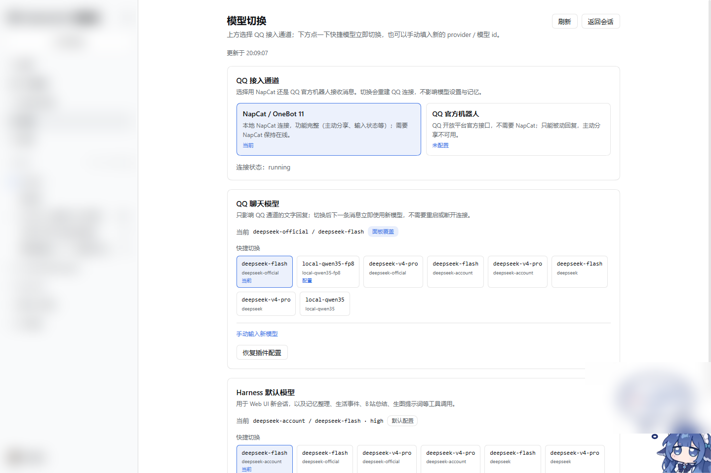
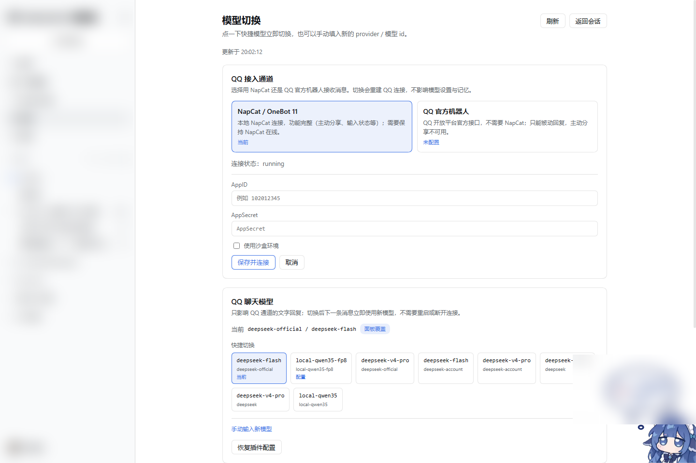

# QQ 官方机器人接入（QQ 开放平台）

> 适用于不想继续走 NapCat / 外部注入的部署。奥菲莉亚仍使用同一份人设、记忆和回复引擎，
> 只是把「收发消息」从本地 OneBot 换成 QQ 开放平台官方 WebSocket + OpenAPI。

## 1. 和 NapCat 的区别

| | NapCat / OneBot 11 | QQ 官方机器人 |
|---|---|---|
| 登录方式 | 本地 NapCat 登录一个 QQ 号 | QQ 开放平台 AppID + AppSecret |
| 风险 | 非官方协议，有账号风险 | 官方接口，不需要注入 |
| 主动消息 | 支持（生活分享、主动搭话） | **不支持**（平台 2025-04 起下线） |
| 输入状态 | 支持（NapCat input_status） | 不支持 |
| 用户标识 | QQ 号 | openid（每个机器人不同） |
| 配置位置 | `onebotUrl` / `accessToken` | 面板填写 AppID / AppSecret，或 `qqbot` 配置 |

两种通道可以在 Web UI 左侧「模型」→「QQ 接入通道」里随时切换，保存后立即重连，不需要重启 Harness。

## 2. 创建机器人

1. 用 QQ 登录 [QQ 开放平台](https://q.qq.com/)。
2. 创建「机器人」应用，进入开发设置，记录：
   - **AppID**
   - **AppSecret**（不是旧版 Token；旧 Token 已弃用）
3. 在开放平台按需要开通消息场景：
   - 单聊（C2C）：用户可以私聊机器人；
   - 群聊：把机器人拉进群，群里 @ 它才会收到消息；
   - 频道：如需频道 @，另开对应 intents。
4. 消息接收方式选 **WebSocket** 即可，本项目会自动调用 `GET /gateway` 连接，
   不需要公网 IP、Webhook 或内网穿透。
   默认 `intents = 33554432`（`1 << 25`，单聊 + 群聊 @）。如果还要接收频道 @，
   在 `cordis.patch.yml` 的 `qqbot.intents` 里改成 `1073741824`（`1 << 30`），
   或两者按位或（`1107296256`）；没有权限的 intent 会导致网关断开。

> 沙盒环境可以在面板勾选「使用沙盒环境」。沙盒适合调试，但只能收到沙盒环境的会话。

## 3. 在 Web UI 里配置

打开 Harness Web UI → 左侧「模型」→「QQ 接入通道」：

1. 点「QQ 官方机器人」卡片；
2. 填写 **AppID**、**AppSecret**；
3. 需要沙盒就勾选「使用沙盒环境」；
4. 点「保存并连接」。

保存后：

- 通道选择与凭据写入
  `companion-data/characters/<角色>/qq/channel.json`；
- 上方「连接状态」会显示 `starting` → `running`；
- 失败时显示错误，例如 `invalid appid`、`QQ access_token 获取失败`、`QQ 网关鉴权超时`。

配置文件里也可以预填（见 `companion-bundle/cordis.patch.yml` 的 `channel` / `qqbot` 段），
但面板保存的值优先。`channel.json` 含 AppSecret，已在 `.gitignore` 中，不要提交。

## 4. 第一次私聊：批准 openid

官方机器人不知道你的 QQ 号，只知道 **openid**。所以第一次私聊时：

1. 机器人只回一条固定提示，不会回复人设或记忆内容；
2. Web UI「QQ 接入通道」下方出现「待批准的 QQBot 用户」；
3. 点「批准」；
4. 之后这个 openid 的消息才会进入奥菲莉亚的回复流程。

如果不想让某个账号使用，点「忽略」。已批准的 openid 会显示在面板里；
想撤销时，可以直接从 `channel.json` 的 `allowOpenids` 中删除（停用插件后编辑）。

群聊场景还需要保证群本身允许机器人发言；如果配置了 `allowGroups`，
群 openid 也要在白名单里（NapCat 和官方通道的群 id 不同，需要分别确认）。

## 5. 官方通道的限制

- **只能被动回复**：每条回复必须携带触发消息的 `msg_id` / `msg_seq`。
  因此 `proactiveEnabled` 的生活分享、注意力主动搭话在官方通道会自动跳过。
- **每条用户消息最多 5 次回复**：本项目在官方通道把气泡限制为 3 条，
  留 2 条给生图说明文字和图片，避免超出限制。
- **单条文本约 2000 字**：官方通道会把气泡控制在 1800 字以内。
- **频道本地图片暂不支持**：单聊/群聊的图片会先上传富媒体再发；
  频道消息只发文字。
- 官方平台有内容审核与频率限制；被限流时会记录到连接错误/日志。

## 6. 排障

| 现象 | 排查 |
|---|---|
| 保存后一直 `starting` / `failed` | 检查 AppSecret 是否复制完整；开放平台机器人是否已上线/沙盒是否正确 |
| `invalid appid` | AppID 填错，或用了另一个应用的 Secret |
| 能连上但收不到私聊 | 开放平台是否开通单聊场景；是否在沙盒环境却用正式 QQ 测试 |
| 收到消息但只回审批提示 | 到面板批准该 openid |
| 群里 @ 没反应 | 群聊场景/权限、机器人是否在群里、`allowGroups` 配置 |
| 想切回 NapCat | 点「NapCat / OneBot 11」卡片，确认 NapCat 的 WS 服务仍在运行 |

日志关键字：`[qq] QQ 官方机器人`、`[qq] 通道接口`、`QQ access_token`、`QQ 网关`。

## 7. 相关代码与路由

- 适配器：`companion-bundle/lib/im/qq-bot.js`
- 通道运行时 / 切换：`companion-bundle/lib/qq-host.js`
- 通道路由：`companion-bundle/lib/qq-channel-routes.js`
- 面板：`companion-bundle/client.js`
- `GET|POST /dsh-companion/qq/channel`
- `POST /dsh-companion/qq/channel/allow`
- `POST /dsh-companion/qq/channel/deny`

官方文档：[QQ 机器人官方文档](https://bot.q.qq.com/wiki/develop/api-v2/)。
