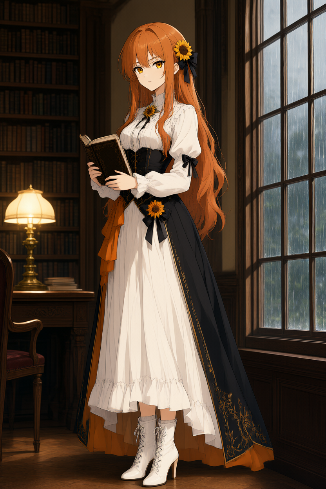

# 奥菲莉亚的生图功能（ComfyUI / Qwen Image 2.1 Turbo）

## 1. 触发

`companion-qq` 在每轮 QQ 消息中，把当前对话交给「画面导演」LLM 判断，只有以下情况才生成：

| 类型 | 说明 |
|---|---|
| `new_scene` | 进入新地点/新场景/新章节 |
| `special_action` | 有画面感的特殊动作：拥抱、奔跑、递伞、摔倒、开门、雨中共伞等 |
| `emotional_peak` | 奥菲莉亚情绪明显激动、脆弱、害羞，或关系明显升温 |

普通寒暄、重复聊天不会触发。两张图最少间隔 10 秒、每天不限制张数，可在 `companion-qq` 配置。

## 2. 时序

```text
主人消息
  ├─ 触发判断（与回复生成并行）
  ├─ 生成文字回复
  ├─ 启动生图任务（首次会先启动 ComfyUI）
  ├─ 先发文字回复
  └─ 图片生成完 → 补发图片
```

生图不会阻塞文字回复的发送；但同一用户队列会等图片任务收尾后再处理下一条。

## 3. 提示词格式

每次先生成固定结构 `ophelia-image-prompt/2`：

```json
{
  "title": "雨夜窗边",
  "scene": "第七阅览室的雨夜",
  "characters": [
    { "name": "奥菲莉亚", "appearance": "银白长发、金红眼瞳", "expression": "安静", "pose": "抬头看向窗外", "clothing": "深色长裙" }
  ],
  "action": "把伞收起来",
  "environment": "旧图书馆、雨声、暖灯",
  "mood": "安静、亲近",
  "composition": "中景，人物偏左，窗户占右侧",
  "lighting": "暖黄台灯与窗外冷雨光",
  "palette": "深棕、金、冷蓝",
  "style": "2D Japanese anime illustration, ...（固定，见下）",
  "aspect_ratio": "2:3",
  "megapixels": 1.2,
  "negative_prompt": "photorealistic, realistic, 3D render, CGI, ... watermark, text, logo, ...",
  "prompt_en": "2D Japanese anime illustration, ...（固定画风在最前面）"
}
```

`prompt_en` 是最终交给 Qwen Image 2.1 Turbo 的英文画面描述。

### 3.1 固定二次元画风（2026-11-11）

之前画风会跟着画面导演/旧记忆变，甚至漂成写实摄影。现在画风**写死**在 `lib/imagegen/prompt.js`：

```js
export const FIXED_IMAGE_STYLE =
  '2D Japanese anime illustration, anime key visual, clean crisp line art, ' +
  'cel shading with soft gradient shadows, flat anime colors, detailed hand-drawn ' +
  'Victorian fantasy costume, expressive anime eyes, elegant gothic-romantic atmosphere, ' +
  'warm ivory black and copper-orange palette'
```

这套描述参考了 `companion-data/characters/ophelia/assets/ophelia-reference.jpg`：
干净线稿 + 赛璐璐上色 + 柔和渐变阴影 + 维多利亚幻想服饰细节。

保证方式（三层）：

1. **提示词最前面**：`prompt_en` 一律以 `FIXED_IMAGE_STYLE` 开头，末尾再补
   `Consistent 2D Japanese anime illustration style.`；
2. **清除漂移词**：模型/旧记忆里的 `photorealistic`、`realistic`、`3D render`、`CGI`、
   `film still`、`photography`、`painterly`、`oil painting` 等会被清掉；
3. **负面词兜底**：每次都会追加固定负面词
   `photorealistic, realistic, realistic photo, photography, film still, live-action, 3D render, CGI ...`。

即使自定义 planner 返回写实提示词，`createImageGenerationService` 在提交 ComfyUI 前还会再锁一次画风。
旧的生成图记忆只作为动作/表情/场景参考，不再能改变画风。

固定画风后的实机效果（本地 Qwen Image 2.1 Turbo）：



提示词来源优先级：

1. 当前上下文 / 奥菲莉亚刚生成的回复；
2. 与场景相关的记忆；
3. **之前的生成图记忆**（只参考外观、动作、表情、场景；画风固定为二次元，不继承旧图风格）。

## 4. 工作流与模型

- **默认工作流**：`companion-bundle/data/comfy/ophelia_qwen_image_2_1_turbo_api.json`（代码内置默认，按 class_type 定位节点）。`ophelia_qwen_image_2_1_turbo_isolated_api.json` 是「独立节点 id」版本，适合与其它工作流共存；需要时用 `comfyWorkflowPath` 覆盖。
- **参考模板（不参与运行）**：`companion-bundle/data/comfy/ophelia_qwen_image_2_1_turbo_t2i.json`（来自 ComfyUI 官方模板，含提示词改写子图；我们已拆出轻量 API 版）
- 如果修改运行时工作流：会影响她；代码按 `class_type` 自动定位，不依赖固定 node id；需要保留 `TextEncodeQwenImage21`（prompt/negative）、`RandomNoise`（seed）、`ResolutionSelector`（尺寸）、`SaveImageAdvanced`（保存）这几类节点。改完重启 Harness 生效。
- 模型：
  - `diffusion_models/qwen-image-2.1-turbo-fp8.safetensors`
  - `text_encoders/qwen3vl_8b_int8_convrot.safetensors`
  - `vae/qwen_image_2.1_vae_bf16.safetensors`
- 默认 1:1；尺寸由提示词规划按具体画面单独决定：aspect_ratio + megapixels（0.8–1.2 特写、1.2–1.6 多人/环境、最多 2.0 宽幅场景），8-step turbo schedule、cfg=1。

## 5. 图片记忆

生成成功后写入：

```json
{
  "source": "imagegen",
  "category": "事件",
  "metadata": {
    "image": true,
    "type": "generated_image",
    "imagePath": "companion-data/characters/ophelia/images/generated/....png",
    "promptFormat": { "...": "..." },
    "prompt": "英文提示词",
    "triggerType": "new_scene",
    "seed": 123
  }
}
```

`MemoryEngine.listImageMemories()` 会把这些记忆列出来，后续生图的提示词规划优先参考。

## 6. ComfyUI 生命周期

- 第一次触发且 8188 未监听：通过 `comfy.exe launch --background` 启动；
- 首次启动可能较久，图片任务会等待；
- 生成成功后保持开启；
- 主人继续聊天会重置空闲计时；默认 10 分钟无活动后，如果 ComfyUI 是插件启动的，就 `comfy stop` 关闭；
- 如果 ComfyUI 本来就是你手动/桌面启动的，插件不会关闭它。

## 7. 配置

```yaml
imagegenEnabled: true
imagegenCooldownMs: 10000
imagegenMaxPerDay: 0
imagegenIdleStopMs: 600000
imagegenTimeoutMs: 600000
comfyUrl: http://127.0.0.1:8188
# 以下路径按你的本机安装位置填写；留空时使用 comfy-cli 的默认配置
comfyCliPath: <comfy-cli 可执行文件路径>
comfyWorkspace: <ComfyUI 安装目录>
# comfyWorkflowPath: <repo>/companion-bundle/data/comfy/ophelia_qwen_image_2_1_turbo_isolated_api.json
comfyStartTimeoutMs: 300000
# 可选：共享模型目录与输入/输出目录
comfyExtraArgs:
  - --extra-model-paths-config
  - <model-paths.yaml>
  - --input-directory
  - <shared-input-dir>
  - --output-directory
  - <shared-output-dir>
  - --enable-manager
```

改完重装 bundle / 重启 Harness 生效。

## 3.5 奥菲莉亚固定外观（2026-11-10）

生图时角色外观以 `companion-data/characters/ophelia/assets/ophelia-reference.jpg` 为准，固定在 `lib/imagegen/prompt.js` 的 `OPHELIA_APPEARANCE`：

- 橙红色/铜橙色长直发、金色/琥珀色眼睛、白皙皮肤；
- 白色维多利亚式高领泡泡袖衬衫、黑色束腰胸衣；
- 白色多层长裙配黑色侧片与橙色饰带；
- 黑色蝴蝶结 + 向日葵/橙色雏菊发饰与胸针、金色刺绣、白色系带短靴；
- 常拿一本深色旧书，神情安静克制。

`normalizeImagePromptFormat()` 会把模型/旧记忆里错误出现的 silver hair / phoenix-red eyes 替换为固定外观，并补上固定服装描述；不会再让银发红眼污染生图。

旧的生成图记忆已清理（旧图备份到本地 `backups/`，不入库），记忆库不再保留 `metadata.image=true` 的旧图。
